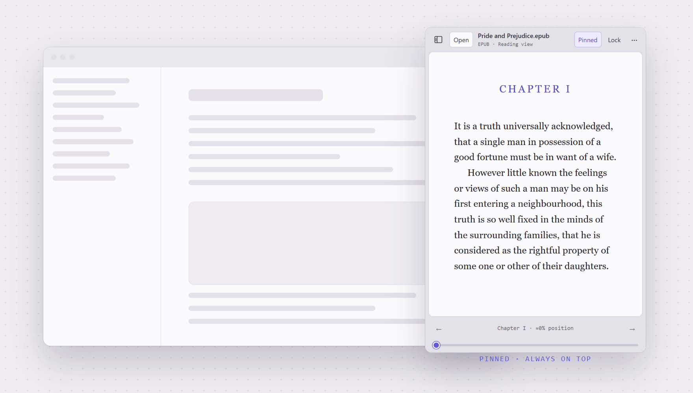
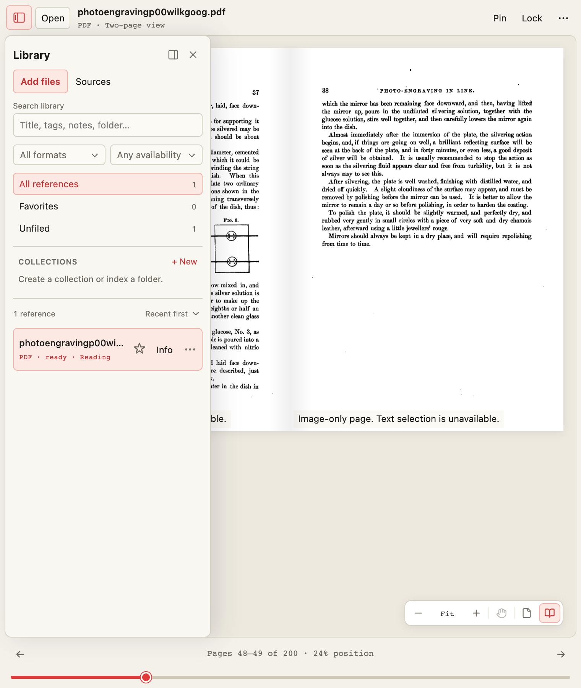
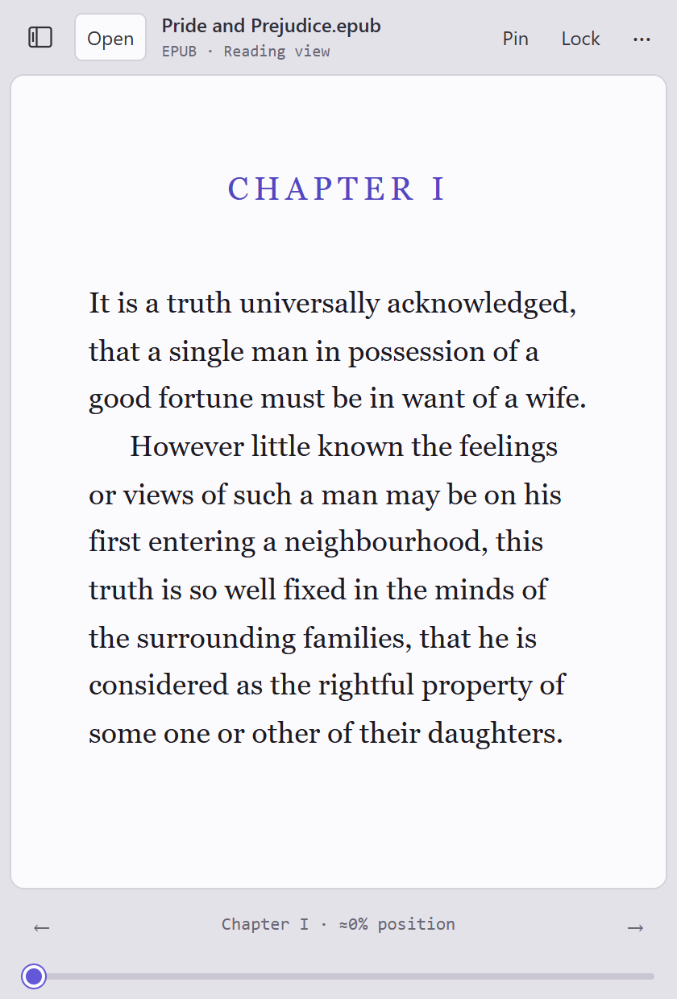
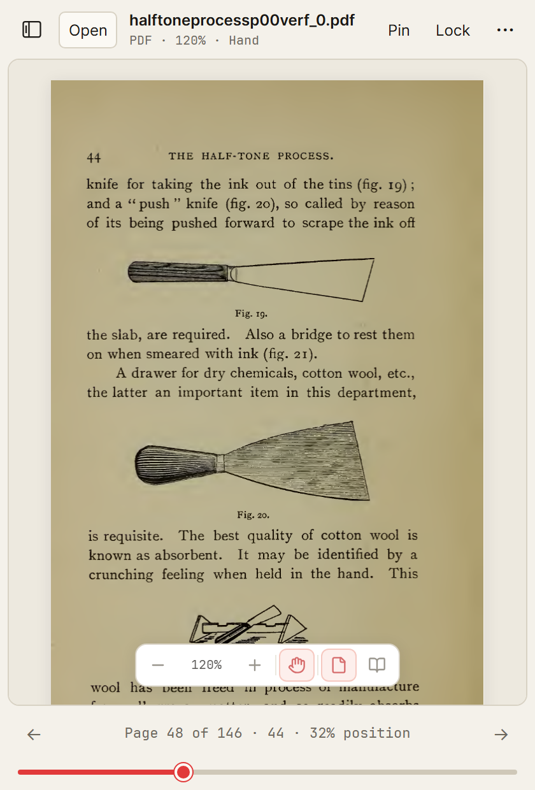
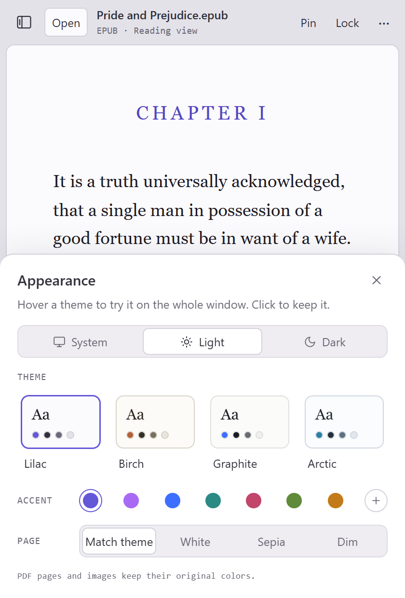
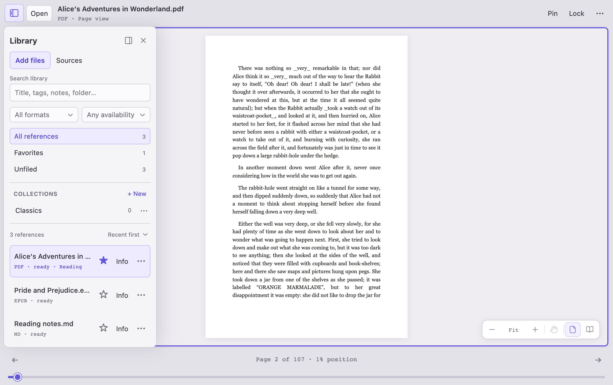
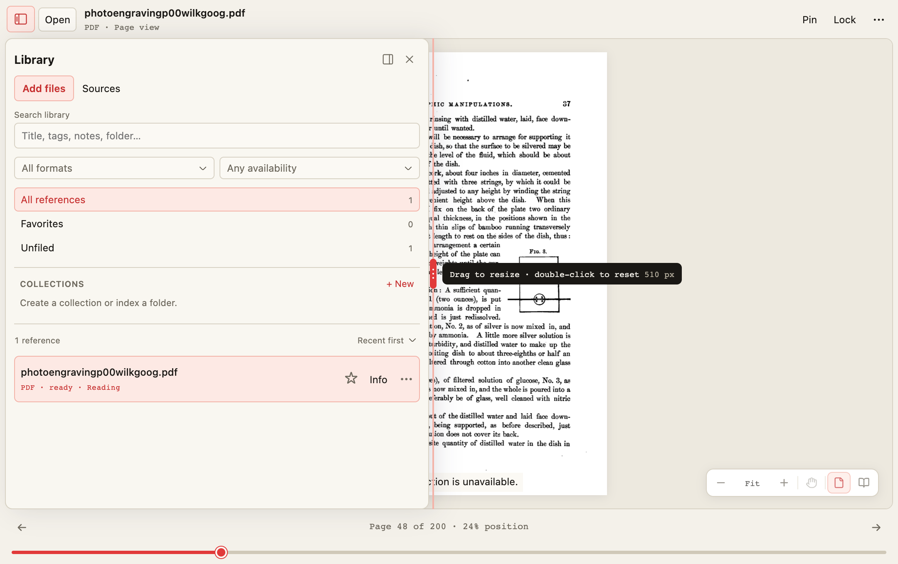
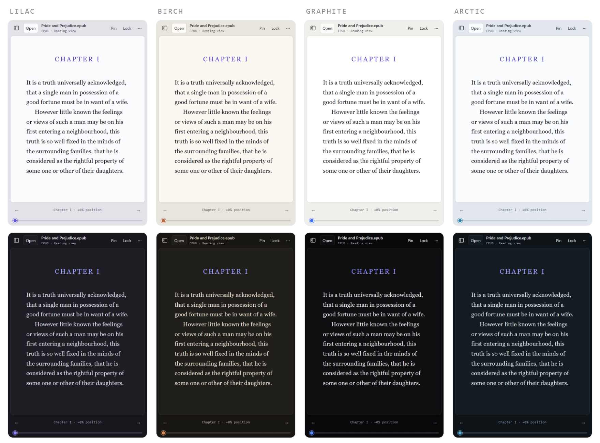
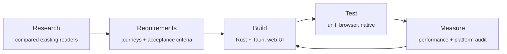

<p align="center">
  <picture>
    <source media="(prefers-color-scheme: dark)" srcset="docs/media/hero-dark.png">
    
  </picture>
</p>

<p align="center">
  
</p>

<h1 align="center">Hold My Brief</h1>

<p align="center">
  <b>A reader that holds.</b><br>
  A small reading window that stays on top of your work and remembers exactly where you left off.
</p>

<p align="center">
  
  
  
  <a href="LICENSE"></a>
</p>

<p align="center">
  <a href="#download"><b>Download for Windows or Mac</b></a> · <a href="docs/user-guide.md">User guide</a>
</p>

---

## Why it exists

Reading something *while* you work (a spec beside a design file, a paper beside your notes, a book on a
second screen) usually means juggling a full-size viewer: switching windows, resizing, scrolling to
find your place again.

Hold My Brief is a pocket-sized window built for that. Pin it above everything else, lock its size so
it never gets in the way, and pick up on the same passage tomorrow. It opens the formats people
actually read (PDF, EPUB books, Markdown, plain text and images), and your files never leave your
computer.

> **Note:** Hold My Brief was previously developed under the name **Float Reader**. The rename
> moves the application-data folder (see the [user guide](docs/user-guide.md#saved-reading-data));
> saved reading positions and libraries from Float Reader builds are not migrated.

## What it does

<table>
  <tr>
    <td width="50%" valign="top">
      <h3>Stays where you put it</h3>
      <b>Pin</b> keeps the window above other apps. <b>Lock</b> fixes its size, so you can still move
      it but never resize it by accident.
    </td>
    <td width="50%" valign="top">
      <h3>Remembers your place</h3>
      Close a book and reopen it next week, even after renaming the file, and you're back on the
      same page, chapter or line.
    </td>
  </tr>
  <tr>
    <td valign="top">
      <h3>Reads what you read</h3>
      PDFs, EPUB books, Markdown notes, plain text and images: faithful pages for PDFs, comfortable
      reflowing text for books. Turn pages, jump to a chapter or scrub through the whole document
      with one slider.
    </td>
    <td valign="top">
      <h3>Opens like a book</h3>
      Show two pages side by side, the way a printed book lies open. Zoom in on a small detail and
      drag the page around by hand. Every control also works from the keyboard.
    </td>
  </tr>
  <tr>
    <td valign="top">
      <h3>A library for your references</h3>
      Collect documents into collections, star favorites, search, or point it at a folder of PDFs.
      It opens as a drawer over the page: widen it, narrow it or move it to either side without the
      page ever moving. It never copies or moves your files.
    </td>
    <td valign="top">
      <h3>Fits your space</h3>
      Light and dark modes that follow your system, five theme families (Brief by default), your own accent
      color, and a page tone for text. Hover a theme to preview it on the whole window.
    </td>
  </tr>
</table>

## A closer look

<p align="center">
  <picture>
    <source media="(prefers-color-scheme: dark)" srcset="docs/media/spread-dark.png">
    
  </picture>
  <br><sub><b>Two-page view</b> lays out a PDF like an open book</sub>
</p>

<table>
  <tr>
    <td align="center" width="33%"><br><sub><b>Reading a book</b> at the default 420 × 620 size</sub></td>
    <td align="center" width="33%"><br><sub><b>Zoom in</b>, then drag the page with the hand tool</sub></td>
    <td align="center" width="33%"><br><sub><b>Appearance</b>: hover to preview, click to keep</sub></td>
  </tr>
</table>

<p align="center">
  <picture>
    <source media="(prefers-color-scheme: dark)" srcset="docs/media/library-dark.png">
    
  </picture>
  <br><sub><b>The library</b> floats over the page. Put it on either side and the page keeps its place</sub>
</p>

<p align="center">
  <picture>
    <source media="(prefers-color-scheme: dark)" srcset="docs/media/library-resize-dark.png">
    
  </picture>
  <br><sub><b>Make it wider</b>: drag the divider and the drawer grows over the page; double-click to reset</sub>
</p>

<p align="center">
  
  <br><sub><b>Five theme families</b>, each in light and dark. Brief is the default</sub>
</p>

## Private by design

- **Your files stay yours.** No account, no cloud, no analytics. It works offline.
- **Documents are never changed.** Reading positions and the library live in a small local data
  folder. Removing something from the library never deletes the file.
- **Nothing runs behind your back.** Scripts inside documents are blocked, books open in a sandbox,
  and web links open only when you click them.

## How it was made

Hold My Brief was planned before it was built, and every claim about it is backed by a test or a
measurement.



| Step | What it produced |
| --- | --- |
| **Research** | A [research brief](docs/floating-reader-research-2026-10-22.md) comparing Readest, Thorium, Koodo, SumatraPDF and PowerToys "Always on Top": what each does well and where none of them fit this use case. |
| **Requirements** | A [product requirements document](docs/floating-reader-prd.md) with user journeys, priorities and testable acceptance criteria for every behavior. For example, "locking the size must survive snapping, maximize and display changes". |
| **Build** | A native Rust/Tauri shell for files, windows and saved state, plus a small web interface using PDF.js, foliate-js and markdown-it. The Windows app is a single ~7 MB executable. |
| **Test** | Unit tests, real-browser scenarios and native tests run on Windows and macOS in [CI](.github/workflows/ci.yml) for every change, including a smoke test that drives the real desktop app. |
| **Measure** | A [performance pass](docs/floating-reader-performance.md) that halved PDF time-to-first-page (248 → 128 ms) and made flipping back and forth through 120 pages 16× faster (2,000 → 122 ms). |

The [implementation status](docs/floating-reader-implementation.md) separates what is verified
from what isn't yet. Hold My Brief is a working release candidate, not a finished 1.0. Open items
such as screen-reader testing and very large files are listed there, not glossed over.

## Download

Get the newest version from the
[latest release](https://github.com/RVYNP/float-reader-public/releases/latest). There's nothing to
sign up for.

| Your computer | File to download |
| --- | --- |
| **Windows** (64-bit) | `Hold-My-Brief-0.1.0-windows-x64-setup.exe` installs it just for you, no administrator needed. Prefer not to install? Unzip `Hold-My-Brief-0.1.0-windows-x64-portable.zip` anywhere and run **Hold My Brief.exe**. |
| **Mac** with Apple silicon (M1 or later) | `Hold-My-Brief-0.1.0-macos-arm64.dmg`. There's no version for Intel Macs yet. |

The version number in each file name changes with every release. To check a download, compare it
with `SHA256SUMS.txt` on the same page.

**The first time you open it.** Hold My Brief isn't code-signed yet, so your computer asks you to
confirm once:

- **Windows:** if a blue "Windows protected your PC" screen appears, choose **More info**, then
  **Run anyway**.
- **Mac:** open the `.dmg` and drag Hold My Brief to Applications. The first time you open it, macOS
  says it can't verify the developer.
  - On macOS 15 (Sequoia) or later, click **Done**, open **System Settings › Privacy & Security**,
    scroll down and click **Open Anyway**.
  - On macOS 14 or earlier, Control-click (or right-click) the app, choose **Open**, then **Open**
    again.

**Let an AI assistant do it.** If you use an AI coding assistant, give it the
[agent setup instructions](docs/agent-setup.md). It will pick the right download, check it, install
it, and tell you what it did.

### Build it yourself

Developers can build from source with Node.js and Rust; the
[development guide](docs/development.md) covers Windows and macOS step by step.

```bash
npm ci
npm run desktop     # launches the app
npm run dev         # or try the interface in a browser
```

## Learn more

| | |
| --- | --- |
| [User guide](docs/user-guide.md) | Every feature, shortcut and setting in detail |
| [Development guide](docs/development.md) | Build, test and package for Windows and macOS |
| [Requirements](docs/floating-reader-prd.md) · [Research](docs/floating-reader-research-2026-10-22.md) | Why it works the way it does |
| [Status](docs/floating-reader-implementation.md) · [Performance](docs/floating-reader-performance.md) · [macOS audit](docs/floating-reader-macos-and-performance-audit.md) | What's verified, what's measured, what's next |

## Brand

The identity is deliberately plain: **the mark is the name, set once.** An acid period is the only
colour move, and everything else is paper, ink and white space.

| | |
| --- | --- |
| **Mark** | *Hmb.* in Inter Bold (capped at 700, never heavier), capital H, acid period |
| **Colour** | Warm paper `#F4F1EA` · true ink `#1A1815` · one acid accent `#E13A3A`, used once per composition |
| **Brief blue** | `#7ADBFE` floods fields (posters, covers, the icon) and stays out of the interface |
| **Type** | Inter for the interface, JetBrains Mono for the machine voice: positions, paths, statuses |
| **Motion** | Slow enough to feel expensive: clip settles at 340 ms, ribbon marks in 500 ms, dither resolves in 900 ms |

The **Brief** theme family ships all of this as the app's default appearance, and the app icon is
the mark itself. Colour, type and motion are documented in full in the brand guidelines that
accompany this project.

**Fonts are not bundled.** The interface asks for Inter and JetBrains Mono, then falls back to the
system faces your computer already has. Nothing is downloaded to render the UI, which keeps the
promise that the app works offline and never phones home. Install Inter and JetBrains Mono if you
want the interface set exactly as designed.

## Credits

The look and theme system are inspired by [Tern](https://stencil.so/tern) by
[Stencil](https://stencil.so). Its quiet, airy styling, its light/dark design tokens and its theme
picker that previews on hover shaped Hold My Brief's Appearance panel. The Graphite theme follows
the default palette in [Tern's published theme tokens](https://docs.stencil.so/tern/styles/variables.html).
Thank you to the Stencil team.

Sample text in the screenshots is from public-domain editions of *Pride and Prejudice* and
*Alice's Adventures in Wonderland* via Project Gutenberg.

## License

[MIT](LICENSE). Third-party components keep their own licenses; see [THIRD_PARTY.md](THIRD_PARTY.md).
