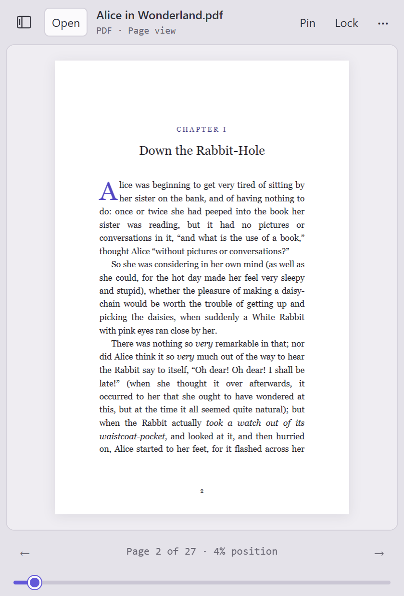
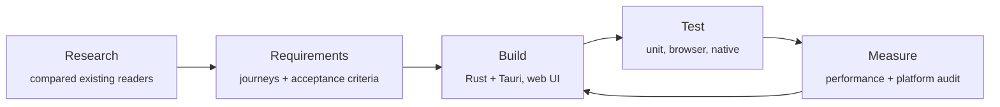

<p align="center">
  <picture>
    <source media="(prefers-color-scheme: dark)" srcset="docs/media/hero-dark.png">
    
  </picture>
</p>

<h1 align="center">Float Reader</h1>

<p align="center">
  <b>A little room to read.</b><br>
  A small reading window that stays on top of your work and remembers exactly where you left off.
</p>

<p align="center">
  
  
  
  <a href="LICENSE"></a>
</p>

---

## Why it exists

Reading something *while* you work (a spec beside a design file, a paper beside your notes, a book on a
second screen) usually means juggling a full-size viewer: switching windows, resizing, scrolling to
find your place again.

Float Reader is a pocket-sized window built for that. Pin it above everything else, lock its size so
it never gets in the way, and pick up on the same passage tomorrow. It opens the formats people
actually read (PDF, EPUB books, Markdown, plain text and images), and your files never leave your
computer.

## What it does

<table>
  <tr>
    <td width="50%" valign="top">
      <h3>Stays where you put it</h3>
      <b>Pin</b> keeps the window above other apps. <b>Lock</b> fixes its size, so you can still move
      it but never resize it by accident.
    </td>
    <td width="50%" valign="top">
      <h3>Remembers your place</h3>
      Close a book and reopen it next week, even after renaming the file, and you're back on the
      same page, chapter or line.
    </td>
  </tr>
  <tr>
    <td valign="top">
      <h3>Reads what you read</h3>
      PDFs, EPUB books, Markdown notes, plain text and images, each shown the way it should be:
      faithful pages for PDFs, comfortable reflowing text for books.
    </td>
    <td valign="top">
      <h3>Moves at the speed of a keyboard</h3>
      Turn pages, jump to a chapter or scrub through the whole document with one slider. Every
      control is also reachable without a mouse.
    </td>
  </tr>
  <tr>
    <td valign="top">
      <h3>A library for your references</h3>
      Collect documents into collections, star favorites, search, or point it at a folder of PDFs.
      It references your files and never copies or moves them.
    </td>
    <td valign="top">
      <h3>Fits your space</h3>
      Light and dark modes that follow your system, four calm theme families, your own accent
      color, and a page tone for text. Hover a theme to preview it on the whole window.
    </td>
  </tr>
</table>

## A closer look

<table>
  <tr>
    <td align="center" width="33%"><br><sub><b>Reading a book</b> at the default 420 × 620 size</sub></td>
    <td align="center" width="33%"><br><sub><b>PDF pages</b> stay faithful to the original</sub></td>
    <td align="center" width="33%"><br><sub><b>Appearance</b>: hover to preview, click to keep</sub></td>
  </tr>
</table>

<p align="center">
  <picture>
    <source media="(prefers-color-scheme: dark)" srcset="docs/media/library-dark.png">
    
  </picture>
  <br><sub><b>The library</b> opens beside the page in wider windows</sub>
</p>

<p align="center">
  
  <br><sub><b>Four theme families</b>, each in light and dark</sub>
</p>

## Private by design

- **Your files stay yours.** No account, no cloud, no analytics. It works offline.
- **Documents are never changed.** Reading positions and the library live in a small local data
  folder. Removing something from the library never deletes the file.
- **Nothing runs behind your back.** Scripts inside documents are blocked, books open in a sandbox,
  and web links open only when you click them.

## How it was made

Float Reader was planned before it was built, and every claim about it is backed by a test or a
measurement.



| Step | What it produced |
| --- | --- |
| **Research** | A [research brief](docs/floating-reader-research-2026-10-22.md) comparing Readest, Thorium, Koodo, SumatraPDF and PowerToys "Always on Top": what each does well and where none of them fit this use case. |
| **Requirements** | A [product requirements document](docs/floating-reader-prd.md) with user journeys, priorities and testable acceptance criteria for every behavior. For example, "locking the size must survive snapping, maximize and display changes". |
| **Build** | A native Rust/Tauri shell for files, windows and saved state, plus a small web interface using PDF.js, foliate-js and markdown-it. The Windows app is a single ~7 MB executable. |
| **Test** | Unit tests, real-browser scenarios and native tests run on Windows and macOS in [CI](.github/workflows/ci.yml) for every change, including a smoke test that drives the real desktop app. |
| **Measure** | A [performance pass](docs/floating-reader-performance.md) that halved PDF time-to-first-page (248 → 128 ms) and made flipping back and forth through 120 pages 16× faster (2,000 → 122 ms). |

The [implementation status](docs/floating-reader-implementation.md) separates what is verified
from what isn't yet. Float Reader is a working release candidate, not a finished 1.0. Open items
such as screen-reader testing and very large files are listed there, not glossed over.

## Try it

There's no packaged download yet. To build it yourself you need Node.js and Rust; the
[development guide](docs/development.md) covers Windows and macOS step by step.

```bash
npm ci
npm run desktop     # launches the app
npm run dev         # or try the interface in a browser
```

## Learn more

| | |
| --- | --- |
| [User guide](docs/user-guide.md) | Every feature, shortcut and setting in detail |
| [Development guide](docs/development.md) | Build, test and package for Windows and macOS |
| [Requirements](docs/floating-reader-prd.md) · [Research](docs/floating-reader-research-2026-10-22.md) | Why it works the way it does |
| [Status](docs/floating-reader-implementation.md) · [Performance](docs/floating-reader-performance.md) · [macOS audit](docs/floating-reader-macos-and-performance-audit.md) | What's verified, what's measured, what's next |

## License

[MIT](LICENSE). Third-party components keep their own licenses; see [THIRD_PARTY.md](THIRD_PARTY.md).
Sample text in the screenshots is from public-domain editions of *Pride and Prejudice* and
*Alice's Adventures in Wonderland* via Project Gutenberg.
